# MBoard

[](LICENSE)
[](https://github.com/Maxyjof/MBoard/actions/workflows/ci.yml)
[](https://nextjs.org)
[](https://nodejs.org)

> 看板的秩序，画布的自由。固定账号登录、全局共享的看板 + 无限画布协作工作台。

MBoard 是一个可以自己部署的小团队协作工作台：看板管任务，无限画布承载想法，Yjs 做实时同步，账号由一份 YAML 白名单控制。
没有注册流程、没有多租户、没有云端依赖，`docker compose up` 就能跑在自己的服务器上。

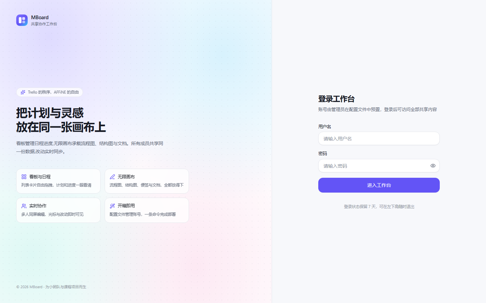

## 功能特性

### 账号与访问
- 账号预置在 `config/accounts.yml`，支持明文密码或 bcrypt 哈希
- 仓库只提供账号模板 `config/accounts.example.yml`，真实账号写在本地 `config/accounts.yml`（已被忽略）
- JWT + HttpOnly Cookie 会话，中间件统一拦截未登录请求
- 登录用户权限平等，所有看板、画板、文档、附件全局共享
- **账号设置**：左下角头像菜单进入，可修改自己的显示名和登录密码
- 深浅色主题、响应式布局

### 看板（Trello 式）
- 看板库先选看板再进入，卡片菜单可重命名 / 删除
- 看板 → 列表 → 卡片三级结构，列表横排拖拽排序
- 卡片跨列表拖动，乐观更新 + 失败回滚
- 每个看板独立维护标签表，顶部「标签管理」可新增 / 重命名 / 改色 / 删除，拖动左侧手柄调整顺序
- 卡片详情抽屉：标题、标签、**多人负责人**、截止时间、Markdown 描述（编辑 / 预览）、附件上传下载、归档、删除
- 新增卡片后直接进入详情编辑
- 看板重命名、描述、主题色、删除，空状态引导

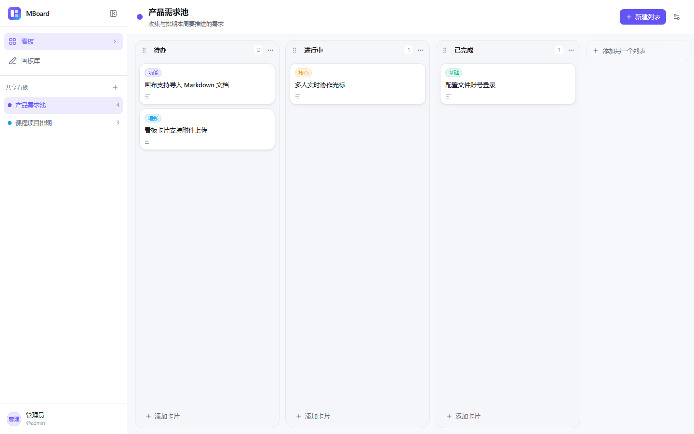

### 负责人与我的任务（Notion 式）
- 每张卡片可以分配一个或多个负责人，成员列表来自账号配置
- 侧边栏「我的任务」汇总所有看板中分配给你的卡片，按看板分组，显示列表、标签、截止时间与负责人
- 任务行显示逾期状态，点击直接跳转到对应看板并自动打开卡片详情
- 负责人变化后，对应的「我的任务」即时反映（刷新页面）

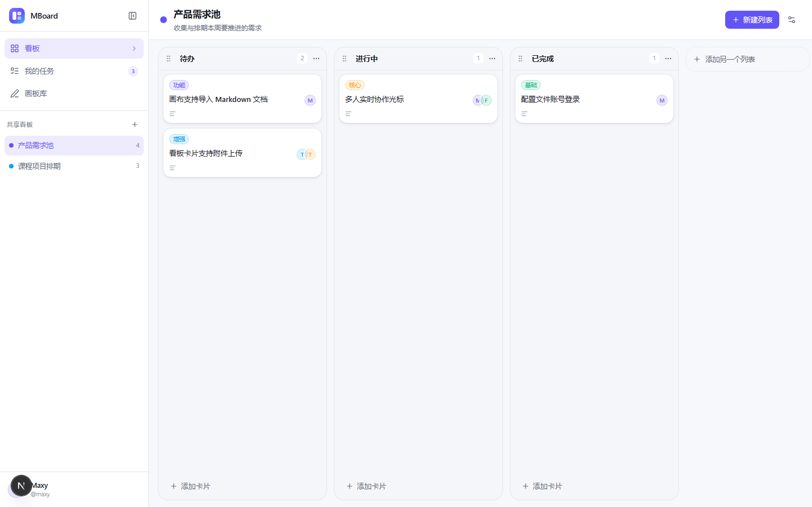

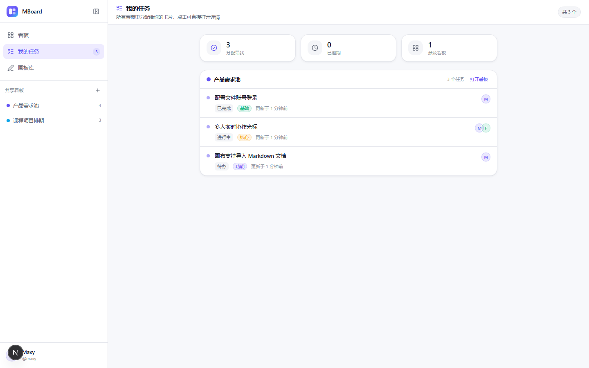

### 无限画布（AFFiNE 式）
- 基于 Excalidraw 内核：无限坐标系、平移缩放、框选、撤销重做、旋转缩放、图层顺序、自由连线与锚点吸附
- 打开画板有路由级加载态；进入画板库后会空闲预热画布引擎，缩短首次打开等待
- 侧栏一键插入：便签、文本、矩形 / 圆形 / 菱形、箭头、图片、视频、Markdown 文档卡片、表格、组合卡片
- **组合卡片（故事卡）**：整张卡是单张图片，双击弹窗编辑；可继续添加/删除成员、上下调整顺序，不会散成多个元素
- **组合卡片收纳**：把画布上的文字或图片直接拖到卡片上，会自动变成字段/图片成员并更新整张卡
- **组合卡片迁移**：旧版由多个元素拼起来的卡片，打开画板时会自动迁移成单张图片
- **画框/容器拖动**：原生画框、组合卡片、分组容器都可以点内部任意空白处直接拖动，不用再找边框
- **画框自由收纳**：画框内组件数量不限，图片/文本拖进去自动成为成员，拖出自动移出；成员可在画框内自由拖动调整位置
- **文档双击打开编辑**：Obsidian 式实时 Markdown 预览，默认显示渲染结果，光标所在行才显示原始语法
- **文件卡片按类型区分**：Markdown / TXT / PDF / Word / Excel / PPT 使用不同图标和底色，双击即可打开
- **表格可视化编辑**：直接点单元格改内容、增删行列，保存自动转成 Markdown 表格
- **拖拽导入**：.md / .txt / .pdf / Office / 图片 / 视频直接拖进画布即可生成文档或文件卡片
- **导入导出**：文档可下载为 Markdown，文件卡片可下载原文件
- **分组**：框选多个元素后点「分组」，生成带标题的容器，拖动任意成员即可整体移动
- 选中画布上的文档卡片时，右侧面板会自动渲染文档内容，不用再点预览
- 图片自动转存资源库并注入画布，避免场景 JSON 膨胀
- 画板库支持缩略图、搜索、重命名、删除、复制链接

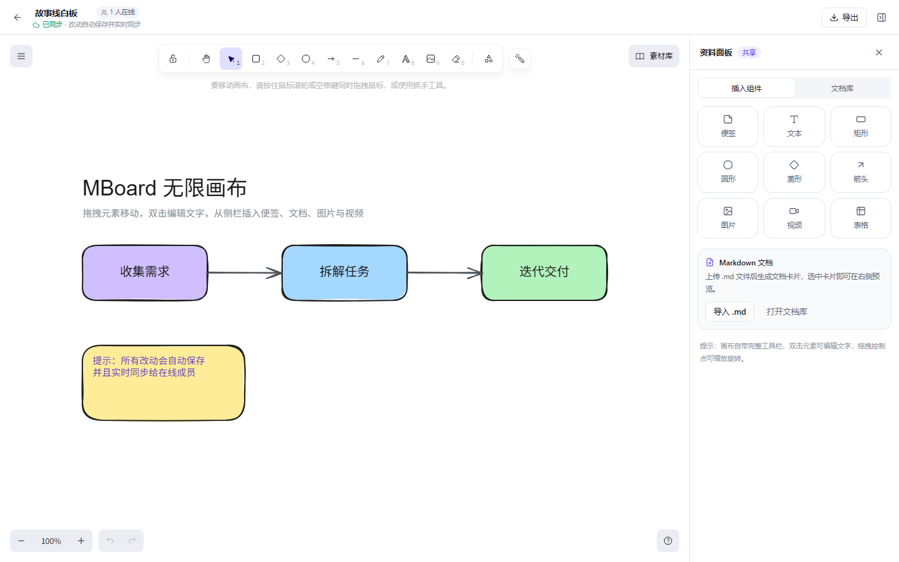

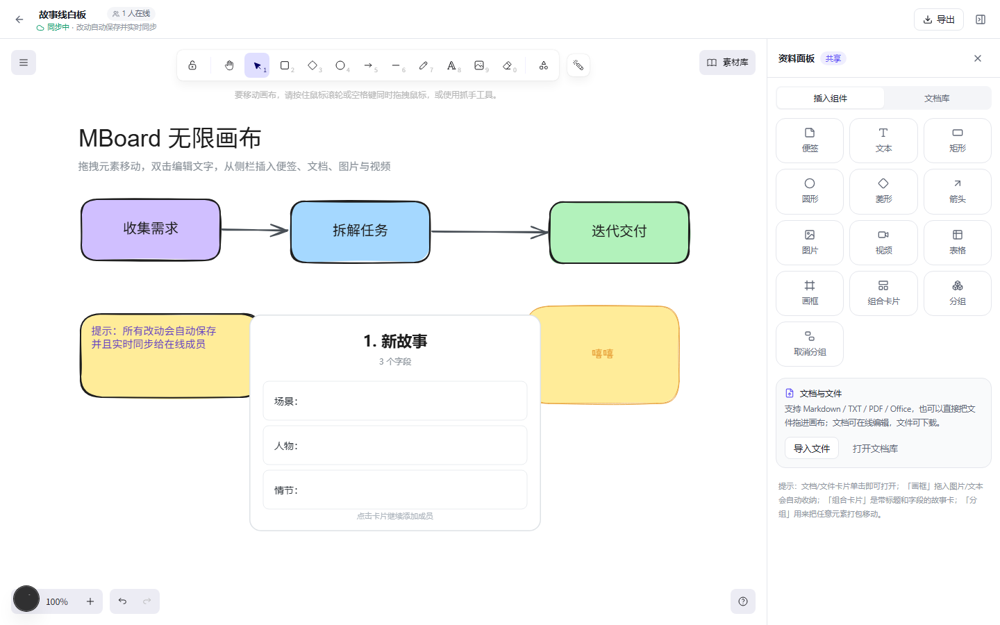

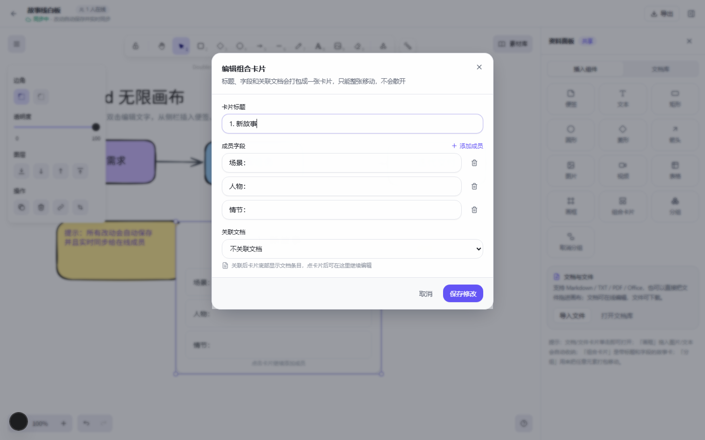

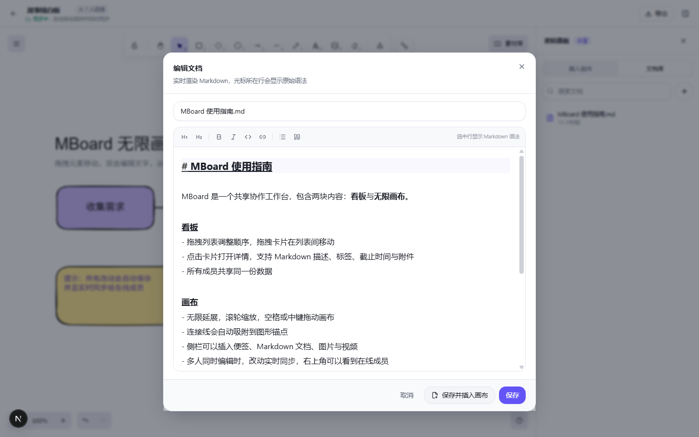

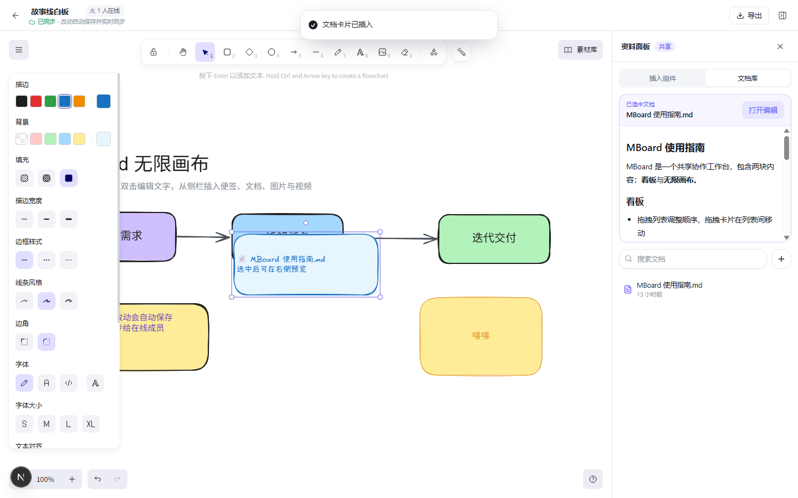

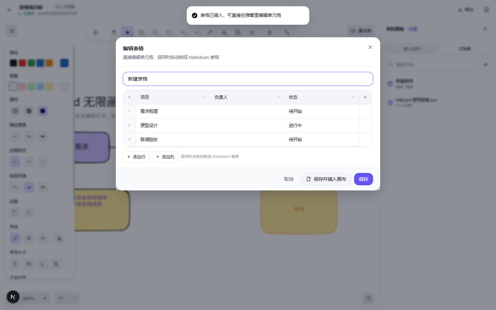

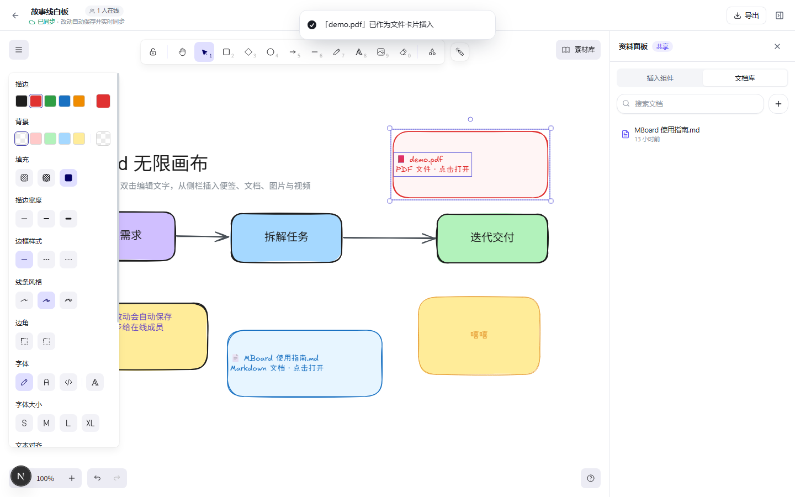

### 实时协作
- 画布基于 **Yjs CRDT + WebSocket**，多人同时编辑自动合并，不会互相覆盖
- 在线成员头像、**带名字的实时光标**、选区高亮、断线重连
- 服务端增量持久化到 SQLite，空闲房间自动卸载
- 画布缩略图由客户端定时导出并上传，画板库实时可见

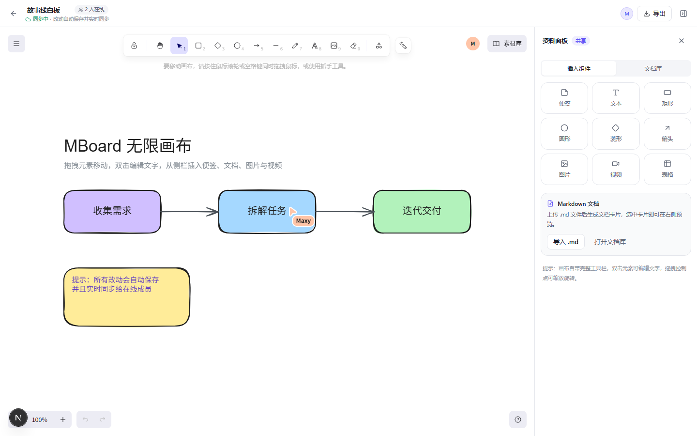

| 看板（深色） | 画布（深色） |
| --- | --- |
| 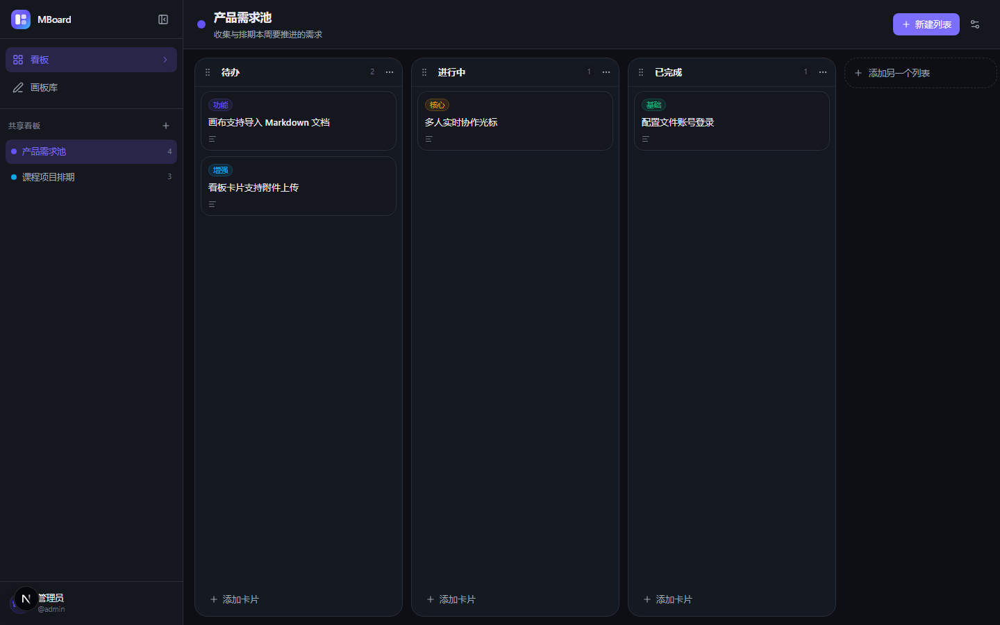 | 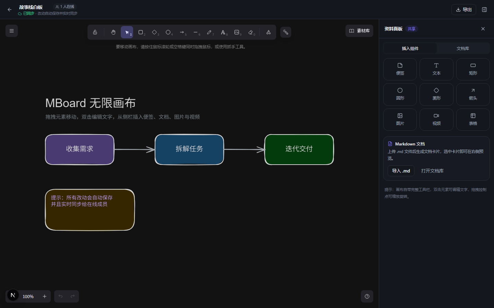 |

### 操作历史与撤销
- 侧栏「操作记录」查看全站最近 30 天的内容变更，看板、列表、卡片、标签、附件、文档与画板资源都可撤销 / 重做
- 每条操作记录执行者，只能撤销自己的操作；目标对象已被别人修改时会拒绝
- 画板元素级撤销 / 重做，支持快捷键；「查看历史」用独立只读画布预览过去的版本，不会回退共享状态
- 画板不再提供「清空画布」，需要新内容时新建画板即可

### 自动更新
- 侧边栏底部「检查更新」直接比对服务器上的 `main` 分支，把新提交列出来
- 确认后通知所有在线用户，全员 15 秒倒计时结束自动退回主界面
- 云服务器拉取代码 → 重建镜像 → 重启容器，**构建或健康检查失败会自动回滚到上一版本**
- 更新中可以在页面里展开实时构建日志，失败时也能直接看到原因
- 执行者是独立的 `mboard-updater` 容器，应用容器不持有 docker 权限，也不碰 git

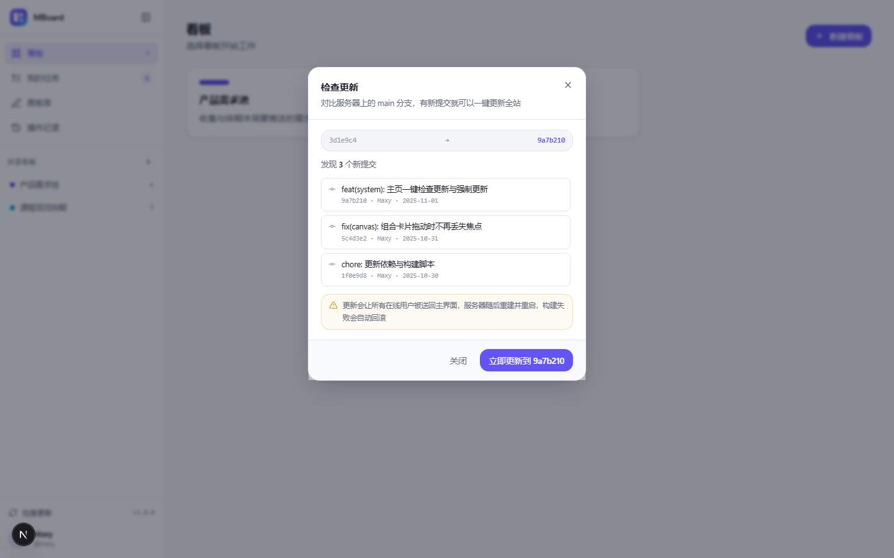

## 技术栈

| 层 | 选型 |
| --- | --- |
| 框架 | Next.js 15.5（App Router）+ React 19 + TypeScript |
| 样式 | Tailwind CSS 3.4 + 自建设计 token / 组件 |
| 数据库 | SQLite + Prisma 6 |
| 画布 | Excalidraw 0.18（MIT）+ 自研 Yjs 协作绑定 |
| 协作 | Yjs + y-protocols + ws（与 Next 共用端口） |
| 拖拽 | dnd-kit |
| Markdown | react-markdown + remark-gfm |
| 鉴权 | jose（JWT）+ bcryptjs |
| 部署 | Docker Compose（应用容器 + 常驻更新容器 + 数据卷） |

## 快速开始（本地）

环境：Node.js ≥ 20、npm。

```bash
cd MBoard

npm install
cp .env.example .env          # Windows PowerShell: copy .env.example .env
cp config/accounts.example.yml config/accounts.yml

npm run setup              # 生成 Prisma Client、建表、写入演示数据
npm run dev                # http://localhost:3000/mboard
```

服务挂在 `/mboard` 子路径下（由 `next.config.mjs` 的 `basePath` 决定），根路径 `/` 不是 MBoard 的页面。

账号来自你本地的 `config/accounts.yml`（已被 `.gitignore` 忽略，不会进入仓库）。

仓库只提供模板 `config/accounts.example.yml`，内含 `admin` / `user2` 两个占位账号，密码均为 `change-me`，请在首次启动前改成自己的账号和密码。

> PowerShell 默认禁止运行 `npm.ps1` 时，用 `cmd /c "npm.cmd run dev"`。

> 开发模式首次访问某个路由会按需编译（可能几秒），启动 dev 后可另开终端执行 `npm run warm` 预先编译主要页面；生产构建没有这个等待。

## Docker 部署

```bash
cp .env.example .env                          # Windows PowerShell: copy .env.example .env
cp config/accounts.example.yml config/accounts.yml
# 修改 .env 里的 AUTH_SECRET，以及 config/accounts.yml 里的账号密码

# 让「检查更新」按钮能工作在服务器上重建，只需执行一次
echo "MBOARD_ROOT=$(pwd)" >> .env

docker compose up -d --build
# 打开 http://服务器IP:3000/mboard
```

- 数据库与上传文件：`./data`（挂载进容器 `/app/data`，备份这个目录即可）
- 账号配置：`./config/accounts.yml`（只读挂载，改完 `docker compose restart`）
- 容器启动时自动执行 `prisma db push` 和幂等种子脚本
- 更新服务由独立的 `mboard-updater` 容器执行，协议与排错细节见本地 `docs/UPDATE.md`
- 反向代理、HTTPS、备份升级见本地 `docs/DEPLOY.md`
  （`docs/` 属于维护者本地文档，不随仓库发布）

## 账号配置

账号白名单写在 `config/accounts.yml`，登录后可以在「账号设置」里改显示名和密码。

```yaml
# config/accounts.yml
users:
  - username: admin
    passwordHash: "$2b$10$..."   # 推荐：bcrypt 哈希
    displayName: "管理员"
    color: "#6353f5"             # 头像底色（光标颜色由画布按用户分配）
```

生成哈希：

```bash
npm run hash -- "你的新密码"
```

修改配置后重启服务生效；新增 / 删除账号只改文件，不需要数据库。

## 账号设置

登录后点击左下角头像 → **账号设置**：

- **修改显示名**：会显示在画布协作光标、在线成员列表和头像上；保存后刷新画布即可看到新名字
- **修改密码**：需要输入当前密码，新密码至少 6 位；修改结果写入数据库，覆盖配置文件里的初始密码，当前登录状态不受影响
- 配置文件仍是账号白名单：删除账号后，即使数据库里还有个人设置也无法登录

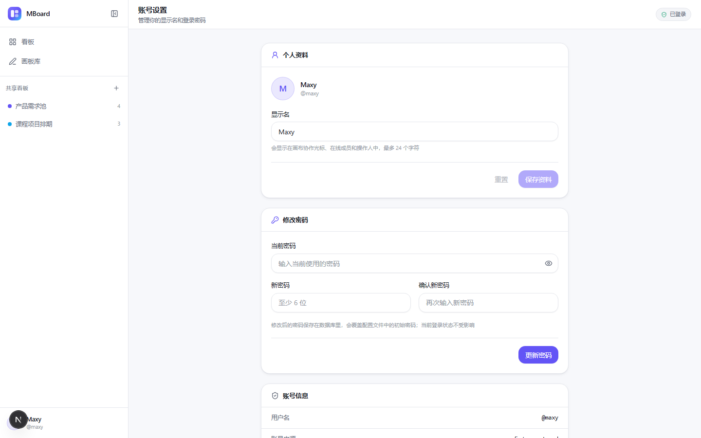


## 常用脚本

| 命令 | 说明 |
| --- | --- |
| `npm run dev` | 开发模式（Next + 协作 WebSocket，同端口） |
| `npm run warm` | 开发态预热：启动 dev 后另开终端执行，提前编译主要路由 |
| `npm run build` / `npm start` | 生产构建 / 启动（生产无按需编译） |
| `npm run setup` | 生成 Client、建表、种子数据 |
| `npm run typecheck` | TypeScript 全量检查 |
| `npm run db:seed` | 手动补种子数据（幂等） |
| `npm run hash -- "密码"` | 生成 bcrypt 哈希 |
| `npm run mock` | 本地假更新服务，不开 docker 也能走完整更新流程 |
| `npm run update:e2e` | 配合 `npm run mock` 的更新流程端到端验证 |

## 目录结构

```text
MBoard/
├── app/                    # App Router：页面与 API
│   ├── (workspace)/        # 带侧边栏的工作台布局
│   │   ├── boards/         # 看板
│   │   └── canvases/       # 画板库
│   ├── canvas/[id]/        # 全屏画布编辑器
│   ├── login/              # 登录页
│   └── api/                # 看板 / 画板 / 资源 / 文档 / 鉴权
├── components/
│   ├── ui/                 # 基础组件
│   ├── workspace/          # 侧边栏、工作台外壳
│   ├── system/             # 检查更新入口与强制更新闸门
│   ├── kanban/             # 看板组件
│   └── canvas/             # 画布编辑器与资源面板
├── lib/
│   ├── auth/               # 会话、账号配置、长连接鉴权
│   ├── collab/             # Yjs 服务端 + 浏览器 Provider
│   ├── system/             # 更新状态通道与 spool 读写
│   └── prisma.ts
├── prisma/                 # schema 与种子数据
├── config/accounts.yml     # 账号白名单
├── docker/                 # 容器入口脚本
│   └── updater/            # 常驻更新容器（git + docker compose）
├── assets/screenshots/     # README 配图
└── server.mjs              # Next + 协作/系统 WebSocket 统一入口
```

## 深入文档

架构设计、接口契约、部署与自动更新的详细说明保留在本地 `docs/` 目录，属于维护者内部资料，不随仓库发布。仓库内的实现以源码与类型定义为准。

## 已知限制

- 看板多人协作以服务端数据为准，其他成员的改动需要刷新或切换页面后可见；画布是实时同步
- 通用上传资源暂未提供独立删除接口（卡片删除后文件保留），画板缩略图会随画板删除清理
- SQLite 单实例写入，适合小团队；水平扩展需换 Postgres 并把 Yjs 持久化迁到共享存储
- 暂未提供历史版本、回收站、权限分级

## 验证脚本（可选）

需要本机 Chrome 与已启动的服务：

```bash
node scripts/collab-test.mjs <canvasId>          # 协议层双端同步测试
node scripts/collab-e2e.mjs <canvasId>           # 双标签页真实协作（仅开发模式）
node scripts/cursor-e2e.mjs <canvasId>           # 双账号光标与用户名验证（仅开发模式）
node scripts/browser-check.mjs /boards board.png # 无头浏览器截图 + 控制台检查
node scripts/mock-updater.mjs                    # 本地假更新服务（不开 docker）
node scripts/update-e2e.mjs                      # 更新流程端到端验证（需先起 mock）
```

> 更新相关的两个脚本只读写 `data/update` 目录，不会碰真实代码与容器，可以随便跑。

## 参与贡献

欢迎提 issue 和 PR，动手前请先读 [贡献指南](CONTRIBUTING.md)，里面写了环境准备、代码约定和提交信息规范。

安全问题请不要开公开 issue，走仓库 **Security → Advisories → Report a vulnerability**，详见 [安全策略](SECURITY.md)。

## 许可证

本项目以 [MIT 许可证](LICENSE) 开源，可自由商用、修改、分发，保留版权声明即可。

第三方组件的完整清单、版本与署名要求见 [NOTICE](NOTICE)。几个值得单独说明的：

| 组件 | 许可证 | 说明 |
| --- | --- | --- |
| Excalidraw | MIT | 画布内核，经 npm 打进前端产物 |
| Vditor、KaTeX、Mermaid、abcjs、markmap | MIT | 编辑器与图表能力 |
| highlight.js | BSD-3-Clause | 代码高亮 |
| Apache ECharts、MathJax | Apache-2.0 | 图表与公式渲染 |
| **Graphviz**（经 Viz.js 打包） | **EPL-1.0** | 仅在浏览器端以目标码形式分发，源码获取途径见 NOTICE |
| **libvips**（经 sharp 引入） | **LGPL-3.0-or-later** | 仅存在于 Docker 镜像中，以动态库形式加载，未静态链接 |
| Prisma | Apache-2.0 | 服务端依赖 |
| caniuse-lite | CC-BY-4.0 | 浏览器兼容性数据，需署名 |

`public/vditor` 由 `scripts/copy-vditor.mjs` 在 `predev` / `prebuild` 阶段从 `node_modules` 复制而来，**不入库**。目录里只有 highlight.js 与 MathJax 会自然带上各自的许可证文本，其余组件以 [NOTICE](NOTICE) 和各依赖包内的许可证为准。

### 商标声明

Trello、AFFiNE、Notion、Excalidraw 等名称是各自所有者的商标。本项目与上述产品没有隶属或合作关系，文档中提到这些名称只为说明功能形态与致谢，不构成任何官方授权、认可或背书。

看板、无限画布、实时协作、自动更新的具体实现见源码，接口约定写在代码与类型定义里。
